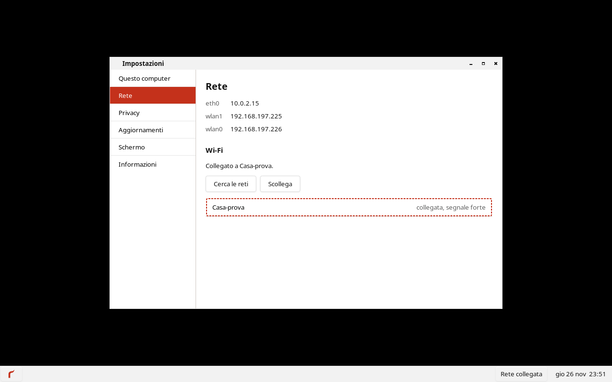

# Tappa 4: pronti per i computer veri

26/11/2026. Questa tappa si chiude solo quando Resurgo avrà girato su qualche computer vero, e quelli non li ho. Intanto ho preparato le immagini per PC perché ci possano partire, e un modo per sapere com'è andata anche senza esserci.

Le prove qui sotto sono ancora in QEMU, sul .51.

## Il kernel con i driver veri

Fino alla tappa 7 le immagini per PC avevano `linux-virt`, il kernel di Alpine per le macchine virtuali: niente driver per le schede video, il Wi-Fi e buona parte dei dischi veri. Ora hanno `linux-lts`. `KERNEL=virt` fa ancora l'immagine solo per macchine virtuali, più piccola.

`linux-lts` ha 143 MB di moduli. Tolgo quelli che su un PC vecchio non servono: InfiniBand, webcam e schede TV, Xen e simili, le schede AMD dal 2014 in poi (`amdgpu`) e le Intel Xe, i filesystem da server (btrfs, xfs, ceph...). Del firmware tengo solo quello per le schede di quegli anni:

- Radeon, cioè le schede ATI fino al 2013;
- Realtek, per il cavo e per il Wi-Fi;
- Broadcom;
- Atheros USB;
- il Wi-Fi Intel fino alla serie 8000, cioè fino al 2015 circa.

Le Intel vecchie per la grafica non vogliono firmware.

L'initramfs porta solo i driver per arrivare al disco: SATA e IDE, USB, NVMe, schede SD. Con i driver video dentro, come vuole Alpine di base, pesava 172 MB.

| | x86_64 | x86 |
| --- | --- | --- |
| sistema prima (linux-virt) | 257 MB | 239 MB |
| sistema con linux-lts | 496 MB | 420 MB |
| sistema ora, con iwd e senza i moduli da server | 494 MB | 421 MB |
| aggiornamento compresso | 224 MB | 166 MB |
| immagine da scrivere, compressa | 236 MB | 175 MB |

Il sistema sta ancora nelle partizioni da 1 GB. Con iwd e dbus (circa 4 MB) la x86_64 era arrivata a 501 MB, sopra il limite dei 500. Ho tolto allora le schede di rete da server (Mellanox, QLogic, Chelsio, Solarflare), i controller Fibre Channel e il target SCSI, circa 6 MB. Il suono SoC (7 MB) resta, perché lo usano i netbook e i tablet Bay Trail. Per togliere altro voglio prima vedere dai rapporti cosa serve davvero.

## BIOS e UEFI sulla stessa chiavetta

La partizione AVVIO ora contiene anche GRUB per UEFI: `BOOTX64.EFI` per x86_64, `BOOTIA32.EFI` per x86. Quest'ultimo è per i PC a 32 bit con UEFI, i primi Atom e i Mac del 2006. Il GRUB per il BIOS resta dov'era, dopo l'MBR.

La tabella delle partizioni resta MBR e la partizione AVVIO resta di tipo FAT32 normale (`c`), non ESP (`ef`). I firmware UEFI la leggono lo stesso, come fanno con le chiavette preparate con Rufus. In più Windows le dà una lettera, e questo serve per leggere il rapporto.

| | BIOS | UEFI |
| --- | --- | --- |
| x86_64 | parte fino al desktop | parte fino al desktop |
| x86 | parte fino al desktop | parte fino al desktop (edk2 a 32 bit) |

Secure Boot non è supportato: va spento.

Ho rifatto anche le prove della tappa 5 su x86_64 col kernel nuovo: corrente staccata durante l'aggiornamento, aggiornamento riuscito, versione guasta con ritorno alla precedente. Riescono tutte e tre.

## Il rapporto sull'hardware

A ogni avvio, dopo due minuti, `resurgo-rapporto` scrive un file di testo nella partizione AVVIO, in `rapporti/`. Contiene:

- modello del computer e BIOS;
- processore e memoria;
- dispositivi PCI e USB, con i loro driver;
- dischi;
- schermi;
- rete;
- sensori, ventole e batteria;
- cosa ha fatto Mantice;
- la pressione su processore, memoria e disco (PSI);
- i servizi;
- gli errori e il firmware mancante nel registro del kernel.

Non contiene numeri di serie, indirizzi MAC o nomi utente, così si può allegare a una issue. Un esempio, preso in QEMU, è in `rapporto-esempio-qemu.txt`.

`prova-qemu.sh` ora copia i rapporti fuori dal disco virtuale, in `out/rapporti-ARCH`. Con `FIRMWARE=uefi` prova l'avvio UEFI dei PC.

## Wi-Fi

Il Wi-Fi lo gestisce iwd, che fa da solo anche il DHCP. Il DNS resta a Unbound: iwd non tocca `resolv.conf`. Con dbus pesa circa 4 MB. Le reti salvate stanno in `/var/lib/iwd`, nella partizione dati, così restano anche dopo gli aggiornamenti.

Ci si collega da Impostazioni › Rete. Ci si arriva anche cliccando su "Rete collegata" / "Nessuna rete" nel pannello, e in quel caso la tastiera parte già dalla prima rete dell'elenco. L'elenco mostra le reti con il segnale e dice se sono aperte, con password o già salvate. Quando serve la password, iwd la chiede alle Impostazioni, che aprono una finestra: così va anche quando la password salvata di una rete è cambiata. Ci sono anche "Scollega" e "Accendi il Wi-Fi", per le schede spente. Le reti aziendali (802.1X) per ora si configurano solo con `iwctl` dal terminale.

Due scelte per la privacy:

- ogni rete vede un indirizzo MAC suo, diverso da quello della scheda (`AddressRandomization=network`);
- iwd non scrive nel registro di sistema. Altrimenti ci finirebbero nome e BSSID di ogni rete a cui ci si collega, cioè dove è stato il computer, in un file che tutti possono leggere.

Il rapporto sull'hardware ora dice anche lo stato degli interruttori del Wi-Fi (rfkill, fisico e software) e delle schede per iwd. I nomi delle reti non ci sono.

La prova in QEMU (`PROVA=wifi`) carica `mac80211_hwsim`, che fa due schede Wi-Fi finte. La seconda fa da punto di accesso con la password. Poi apre le Impostazioni sulla rete, preme Invio sulla rete, scrive la password con la tastiera finta di QEMU (`MISURA tasti ...` sulla seriale) e controlla il risultato. La scheda si collega e prende l'indirizzo, la rete resta salvata e il MAC è casuale.

## Come si prova

Tutto il procedimento è in `prova-su-pc-vero.md`: scrivere la chiavetta, scegliere da dove partire, cosa guardare, dove trovare il rapporto.

## Cosa manca

- le prove vere, su più computer possibile e di anni diversi;
- le reti Wi-Fi aziendali (802.1X) dalle Impostazioni;
- il kernel per le schede ARM vere (Raspberry Pi);
- Favilla nelle immagini normali.
