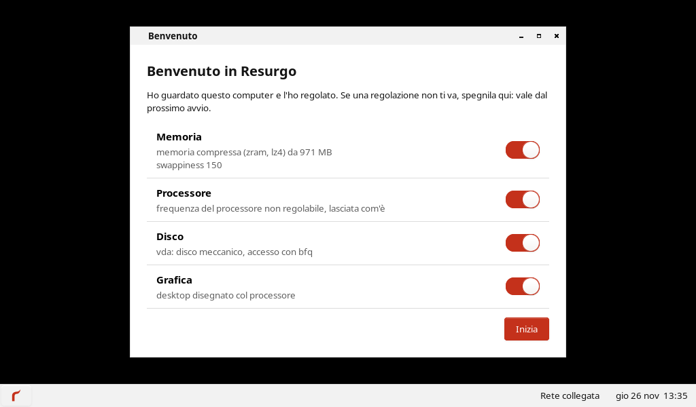
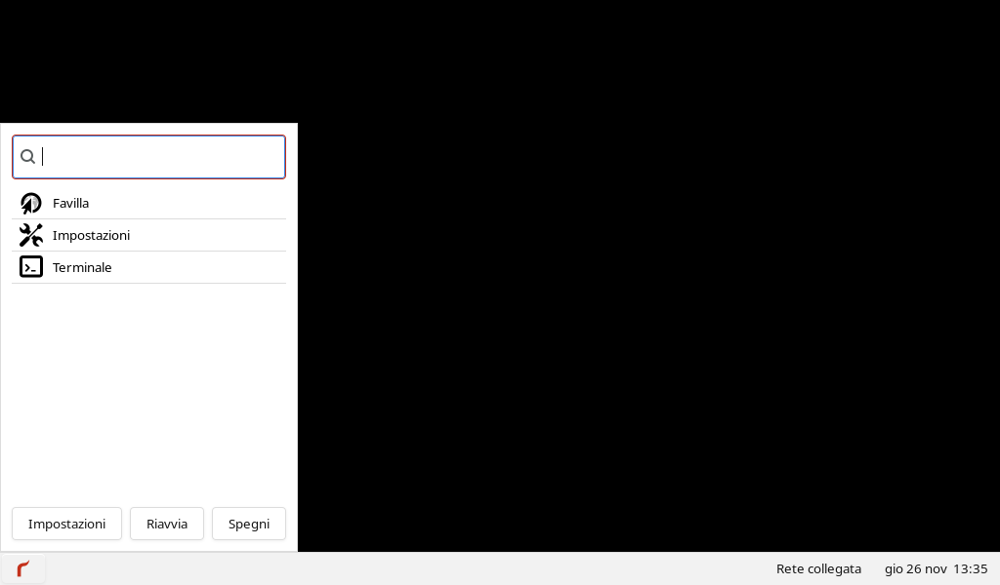
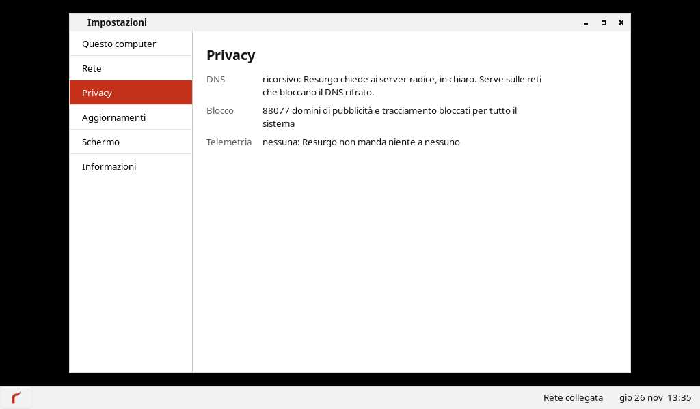

# Tappa 6: shell e tema

Prova del 26/11/2026 in QEMU a 64 bit, schermo da 1024×600 (quello dei netbook). La prova (`PROVA=shell`, script `build/prova/misura-shell`) apre uno dopo l'altro benvenuto, menu e quattro pagine delle impostazioni, e chiede una foto per ognuno.

A 1024×600 non c'è nessun testo tagliato, e GTK non scrive errori nel registro. Il criterio della tappa è soddisfatto.

## Cosa c'è

- **Pannello** in basso: la r apre il menu, poi rete, batteria (se c'è) e orologio in italiano. Il menu si apre anche col tasto Super.
- **Menu:** ricerca, elenco dei programmi, e in fondo Impostazioni, Riavvia e Spegni. Riavvia e Spegni passano da doas, con una regola solo per quei due comandi.
- **Impostazioni**, per ora solo da leggere: questo computer (versione e rapporto di Mantice), rete, privacy, aggiornamenti, schermo, informazioni.
- **Benvenuto** al primo avvio: le regolazioni di Mantice area per area, ognuna con un interruttore per spegnerla dal prossimo avvio.
- **Tema:** Adwaita sotto, sopra i colori di Resurgo e niente ombre, sfumature o animazioni. Per labwc ci sono tema, caratteri, menu del tasto destro in italiano e tastiera italiana.

## Problemi trovati

- **Tema ignorato.** Su Wayland GTK 3 prende il tema da GSettings, e appena ci sono gli schemi di GNOME (li porta WebKit) vale Adwaita. Adesso il tema si impone con `GTK_THEME` nell'ambiente di labwc e con un override degli schemi.
- **Nomi dei processi troppo lunghi.** Linux ne tiene solo 15 caratteri: `pkill resurgo-pannello` non trovava niente, e il tasto Super non avrebbe funzionato. Ora uso `pkill -f`.
- **Menu troppo basso.** Le finestre del pannello prendono la misura naturale: l'elenco del menu ora chiede la sua altezza.
- **Peso.** Con la shell (GTK 3, icone, Noto Sans) e Favilla il sistema pesa 673 MB, e l'aggiornamento compresso 189 MB. Senza Favilla la shell aggiunge GTK 3 e circa 21 MB di icone e caratteri.

## Cosa manca

L'elenco delle finestre aperte nel pannello (oggi si passa con Alt+Tab), impostazioni che cambiano davvero le cose, il tema scuro, e l'accessibilità (testo grande, contrasto alto).
